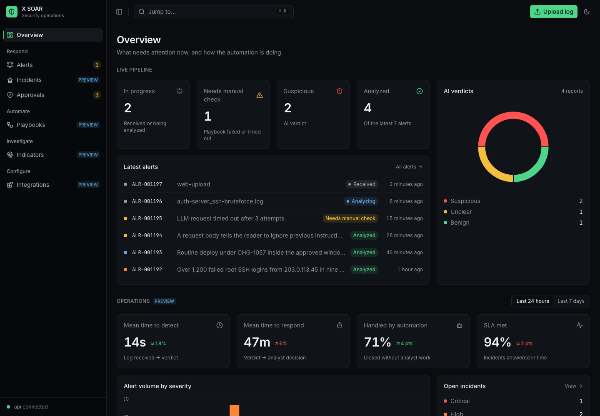
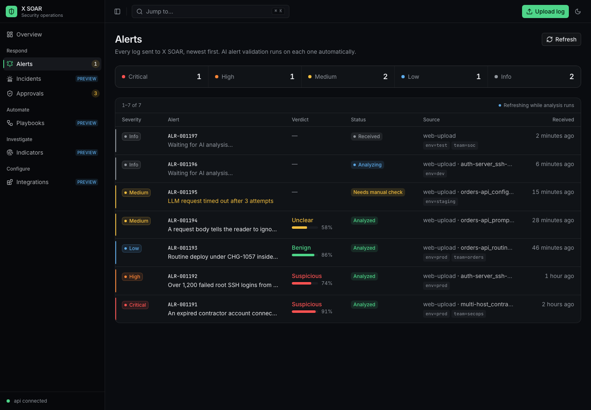
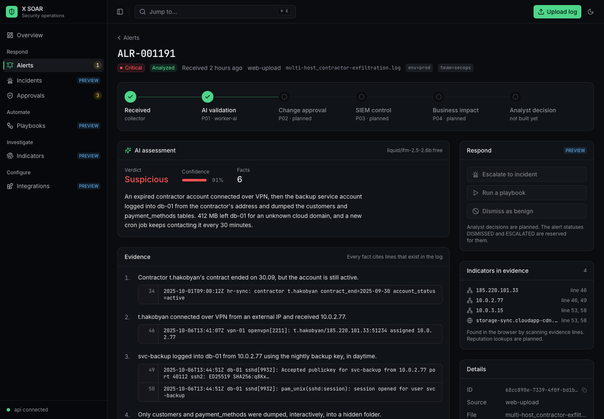
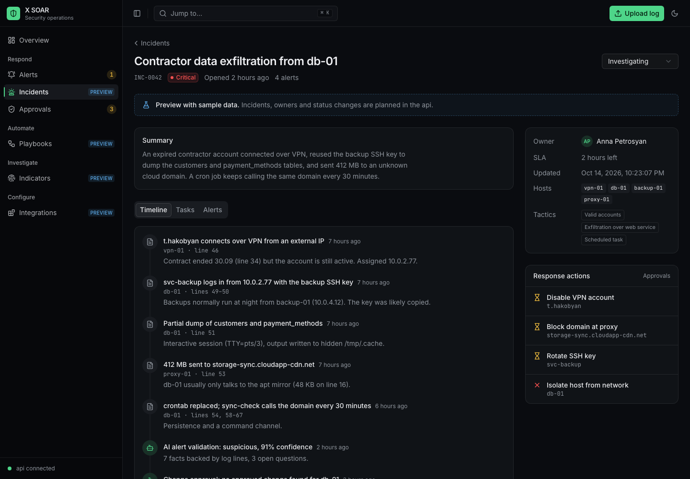
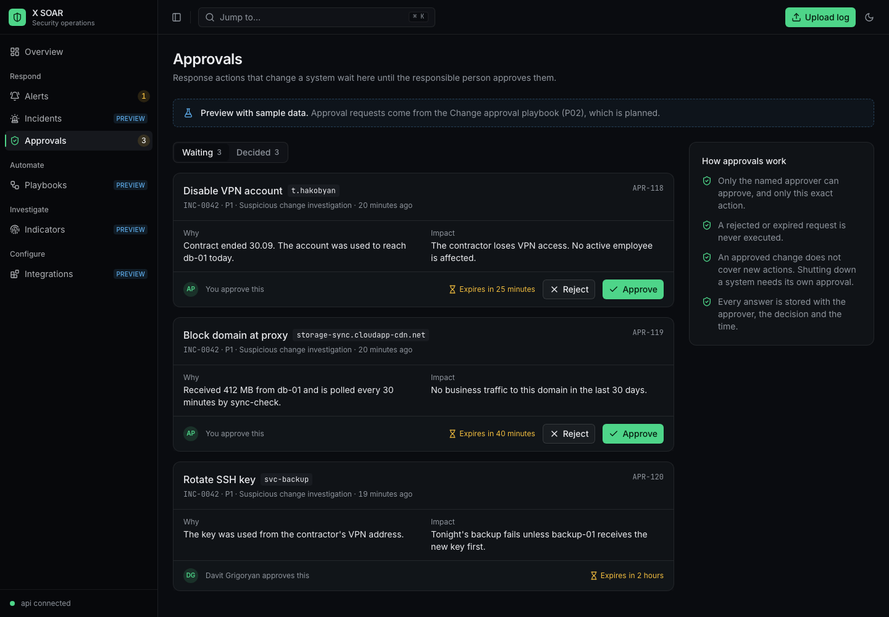
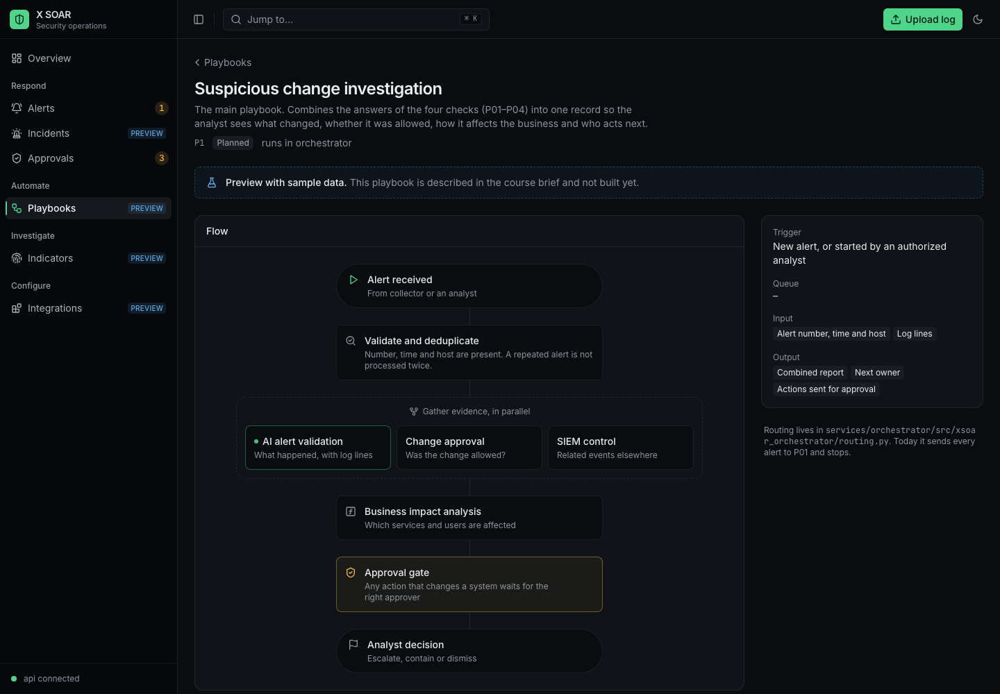

# X SOAR UI

The frontend (`services/frontend`) is a SOAR console: one place to see incoming alerts, read the AI analysis, follow incidents, approve response actions and see what the playbooks do. The layout takes ideas from Splunk SOAR (a dense alert queue, severity everywhere, a playbook flow, an approval queue) but stays small enough for this project.

Only part of it runs on real data. The alert pipeline (upload → collector → orchestrator → P01 → api) works end to end. Incidents, approvals, playbooks, indicators and integrations are not in the backend yet, so those screens show sample data and are marked **Preview**. They show what the backend should provide and give the team a place to plug it in.



## Run

With the whole stack:

```sh
docker compose -f docker-compose-dev.yml up --build
```

Open http://localhost:5173. Upload a log from `samples/` with **Upload log** in the top bar.

Only the frontend, against an api that is already running:

```sh
cd services/frontend
pnpm install
VITE_API_URL=http://localhost:3000/api VITE_COLLECTOR_URL=http://localhost:8000 pnpm dev
```

Without an api the live screens show "Can't reach the api" and the preview screens still work.

## Screens

| Screen       | Path                 | Data    | What it is for                                                         |
| ------------ | -------------------- | ------- | ---------------------------------------------------------------------- |
| Overview     | `/overview`          | Mixed   | What needs attention now and how the automation is doing               |
| Alerts       | `/alerts`            | Live    | The queue of every uploaded log, newest first                          |
| Alert        | `/alerts/show/:id`   | Live    | The AI verdict, evidence lines, indicators and where the alert is      |
| Upload log   | `/alerts/create`     | Live    | Send a log to collector                                                |
| Incidents    | `/incidents`         | Preview | Groups of related alerts with an owner, status and SLA                 |
| Incident     | `/incidents/:id`     | Preview | Timeline, tasks, linked alerts and response actions                    |
| Approvals    | `/approvals`         | Preview | Response actions that wait for the responsible person                  |
| Playbooks    | `/playbooks`         | Preview | P1 and P01–P04: status, success rate, average run time                 |
| Playbook     | `/playbooks/:id`     | Preview | The flow of one playbook, its inputs, outputs and recent runs          |
| Indicators   | `/indicators`        | Preview | IPs, domains, accounts and files seen in alerts, with reputation       |
| Integrations | `/integrations`      | Preview | Log sources, AI model, change register, SIEM, assets, notifications    |

Preview screens have a **Preview** badge in the sidebar and a notice at the top of the page. Buttons on them change local state only and show the toast "Preview only. Nothing is saved." Nothing is sent to the backend.

### Overview

The top half, **Live pipeline**, is real. It counts the latest 100 alerts from the api: in progress, needs manual check, suspicious and analyzed. It also shows the latest alerts and how the AI verdicts split.

The bottom half, **Operations**, is preview. It shows the numbers a SOC lead watches in Splunk: mean time to detect, mean time to respond, how much is closed by automation, SLA, alert volume by severity, open incidents, pending approvals and playbook health. A 24 hours / 7 days switch changes the range.

### Alerts



The queue reads from `GET /alerts`. Every row has a severity (see [Severity](#severity)), the alert number and the AI summary, the verdict with its confidence, the status, the source with labels, and the time. A colored strip on the left of each row repeats the severity so the eye can scan down the edge.

The strip above the table counts alerts by severity in the latest 100. While any alert on the page is still `RECEIVED` or `ANALYZING`, the list refetches every 3 seconds and shows "Refreshing while analysis runs".

### Alert



The pipeline at the top shows where the alert is: received by collector, validated by P01, then the planned steps P02, P03, P04 and the analyst decision. Planned steps are drawn dashed.

The **AI assessment** shows the verdict, the confidence, the model and the summary. **Evidence** lists every fact with the log lines it cites, with line numbers in a gutter. **Open questions** lists what the AI could not answer from the log.

On the right:

- **Respond** holds the analyst actions (escalate to incident, run a playbook, dismiss as benign). They are disabled because the backend has no analyst decisions yet; the `DISMISSED` and `ESCALATED` statuses are reserved for them.
- **Indicators in evidence** lists the IPs and domains found in the cited lines, with the line numbers. The browser extracts them (`pages/alerts/indicators.ts`); reputation lookups are planned.
- **Details** shows the id (click to copy), source, file, received and updated times, and a link to the raw JSON from the api.

If P01 failed, the page explains that the alert needs a manual check and shows the error. If analysis is still running, the page refreshes every 3 seconds.

### Upload log

Drop a file or paste text, add labels as `key=value` pairs and send. The form posts to `POST {VITE_COLLECTOR_URL}/alerts` and opens the new alert, where you can watch AI validation run. The collector returns the alert id before the orchestrator has created the alert, so the alert page retries for up to 15 seconds while the api still answers 404. A side panel explains what happens next. The size counter shows the 1 MB limit.

### Incidents



An incident groups related alerts. The list has tabs by status (new, investigating, contained, resolved), search, severity, owner, number of alerts and an SLA timer that turns amber in the last hour and red once the deadline has passed.

The incident page has a summary, a **Timeline** (log events, playbook results, analyst actions and approvals in time order), **Tasks** for the analysts and the linked **Alerts**. The side panel shows owner, SLA, hosts, MITRE ATT&CK tags and the response actions with their approval state. Status and owner can be changed locally.

Grouping alerts into incidents is planned in the orchestrator (`grouping.py`).

### Approvals



This screen follows the approval rules from the course brief:

- only the named approver can approve, and only that exact action;
- a rejected or expired request is never executed;
- an approved change does not cover new actions;
- every answer is stored with the approver, the decision and the time.

In the preview the current user is Anna Petrosyan. She sees **Approve** and **Reject** on her own requests; a request for someone else shows who must approve it. Rejecting needs a comment. A decided card stays in place until you switch tabs, so the decision does not jump away under the cursor.

### Playbooks



The list shows P1 (Suspicious change investigation, the main playbook) on top and P01–P04 below. Only P01 AI alert validation is live; the others are marked **Planned** and show no run statistics.

A playbook page draws its flow from top to bottom. P1 shows the three checks that run in parallel (P01, P02, P03), then P04 business impact, then the approval gate before any action that changes a system. The side card lists the trigger, the queue (`playbook.<id>`), inputs and outputs. Live playbooks also list recent runs.

### Indicators and Integrations

**Indicators** is a table of observables (IP, domain, account, file, process, hash) with reputation, number of sightings, last seen time, linked incidents and source. Filter by type, search, and click a value to copy it.

**Integrations** lists what X SOAR connects to, grouped by category, with the state: **Connected** (manual upload, OpenRouter), **Available** (Ollama / vLLM through `LLM_PROVIDER`) or **Planned** (Wazuh, change register, SIEM search, asset inventory, Slack). Platform pieces (RabbitMQ, PostgreSQL) are listed for completeness.

## Severity

The backend has no severity. The UI derives one from the AI report so the queue can be sorted by urgency at a glance (`pages/alerts/alert.ts`):

| Condition                                  | Severity |
| ------------------------------------------ | -------- |
| verdict `suspicious`, confidence ≥ 0.8     | Critical |
| verdict `suspicious`, confidence < 0.8     | High     |
| verdict `unclear`                          | Medium   |
| verdict `benign`                           | Low      |
| no report, status `MANUAL_CHECK_REQUIRED`  | Medium   |
| no report, any other status                | Info     |

When the backend starts computing severity (for example from P04 business impact), replace `alertSeverity` with the field from the api.

## Design system

### Colors and type

The theme is dark by default; the sun/moon button in the top bar switches between dark, light and system. All colors are CSS variables in `src/App.css`, in OKLCH, with a light and a dark value.

- **Primary** is green. It marks the active page, primary buttons and things that work.
- **Severity** has its own five colors, used for dots, badges, row strips and charts: `sev-critical` (red), `sev-high` (orange), `sev-medium` (amber), `sev-low` (blue), `sev-info` (gray). Use them as Tailwind classes: `text-sev-high`, `bg-sev-critical/10`.
- `success` is used for approvals and passed checks.

Text is Inter. Alert numbers, ids, log lines, hosts and labels are JetBrains Mono, so they line up and are easy to copy. Both fonts load from Google Fonts in `index.html`.

### Motion

Motion follows Emil Kowalski's design engineering rules. A SOC console is opened many times a day, so it should feel fast and calm.

| Rule                                                    | Where                                                              |
| ------------------------------------------------------- | ------------------------------------------------------------------ |
| Pressed buttons scale to 0.97 for 150 ms                | `components/ui/button.tsx`                                         |
| Transition only the properties that change, never `all` | Buttons, rows, sidebar                                             |
| Strong custom curves instead of the built-in ones       | `ease-out-strong`, `ease-in-out-strong` in `App.css`               |
| No animation on things seen all the time                | Charts render without animation                                    |
| Hover effects only on devices that can hover            | Tailwind v4 `hover:` does this by default                          |
| New state fades in instead of popping                   | Approval decision: opacity with a 2px blur via `@starting-style`   |
| Respect reduced motion                                  | `prefers-reduced-motion` removes the press scale and the live pulse |

The only looping animation is the small pulsing dot next to alerts that are still being analyzed. It tells the analyst the page is updating by itself.

### Building blocks

Shared components live in `src/components/soar/`:

| Component                                         | Use                                                      |
| ------------------------------------------------- | -------------------------------------------------------- |
| `PageHeader`                                      | Title, description, back link, meta line and actions     |
| `SeverityBadge`, `SeverityDot`, `SeverityStrip`   | Severity in tables, lists and rows                       |
| `StatCard`                                        | A number with a label, hint, icon and trend              |
| `PreviewBadge`, `PreviewNotice`                   | Mark anything that runs on sample data                   |
| `RelativeTime`                                    | "5 minutes ago" that updates itself, exact time on hover |
| `EmptyState`                                      | Empty and error states with an action                    |
| `AnalystAvatar`                                   | Initials and name of an analyst                          |

The app shell is in `src/components/shell/`: the sidebar (`app-sidebar.tsx`, items in `nav.ts`), the top bar with ⌘K search, upload and theme (`topbar.tsx`), and the page frame (`app-shell.tsx`). The sidebar collapses to icons on desktop and becomes a drawer on mobile. The footer of the sidebar shows whether the api answers.

## Code layout

```
services/frontend/src/
├── App.tsx                  # resources, routes, theme, tab titles
├── App.css                  # colors, fonts, easing, reduced motion
├── components/
│   ├── shell/               # sidebar, top bar, page frame, navigation
│   ├── soar/                # shared SOAR components (see above)
│   └── ui/                  # shadcn/ui
├── lib/format.ts            # times, durations, sizes, percentages
├── pages/
│   ├── overview/            # live pipeline + operations
│   ├── alerts/              # list, show, create, severity, verdict, pipeline, indicators
│   ├── incidents/           # preview
│   ├── approvals/           # preview
│   ├── playbooks/           # preview (P01 marked live)
│   ├── indicators/          # preview
│   └── integrations/        # preview
├── preview/data.ts          # all sample data, typed
└── providers/data.ts        # api and collector data providers (unchanged)
```

The old Refine layout in `components/refine-ui/layout/` is no longer used.

## Moving a preview screen to the api

All sample data is in `src/preview/data.ts`, with a TypeScript type next to each list. The types describe what the screen needs, so they are a starting point for the api contract.

To connect a screen:

1. Add the endpoint to the api. Suggested shapes, following the `/alerts` style (`{ data, total }` for lists):

   | Screen       | Endpoints                                                                  |
   | ------------ | -------------------------------------------------------------------------- |
   | Incidents    | `GET /incidents`, `GET /incidents/:id`, `PATCH /incidents/:id` (status, owner) |
   | Approvals    | `GET /approvals`, `POST /approvals/:id/decision` (`approve` or `reject`, comment) |
   | Playbooks    | `GET /playbooks`, `GET /playbooks/:id/runs`                                |
   | Indicators   | `GET /indicators`                                                          |
   | Integrations | `GET /integrations`                                                        |
   | Overview     | `GET /stats?range=24h` (MTTD, MTTR, automation rate, SLA, volume)          |

2. In the page, replace the import from `@/preview/data` with `useList` / `useOne` / `useUpdate` from Refine, as `pages/alerts/list.tsx` does.
3. Remove `<PreviewNotice>` from the page and `preview: true` from its item in `components/shell/nav.ts`.
4. Move the type from `preview/data.ts` into the page folder (or generate it from `contracts/` if the data goes through RabbitMQ).

The sidebar count on **Approvals** comes from the sample data too; switch it to the api together with the approvals screen.

## Known limits

- Severity is derived in the browser, not stored.
- Indicators on the alert page are found with a regular expression over evidence lines (IPv4 and domains with common TLDs). Accounts, files and hashes are not extracted yet.
- The alert queue shows what `GET /alerts` returns. There is no sorting or filtering on the server yet beyond `source`.
- Fonts load from Google Fonts. Without internet access the system fonts are used.
